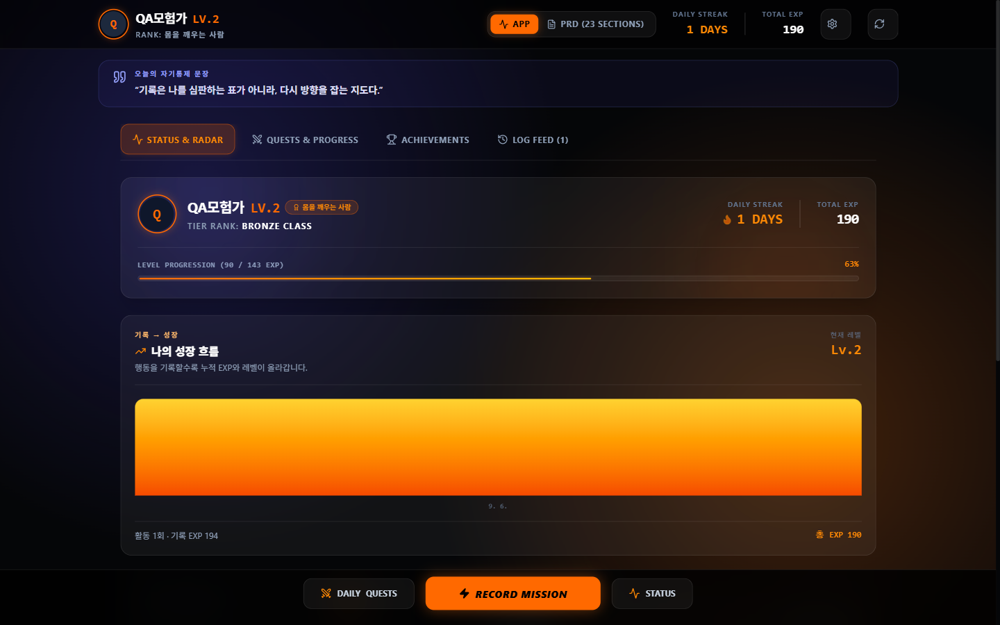
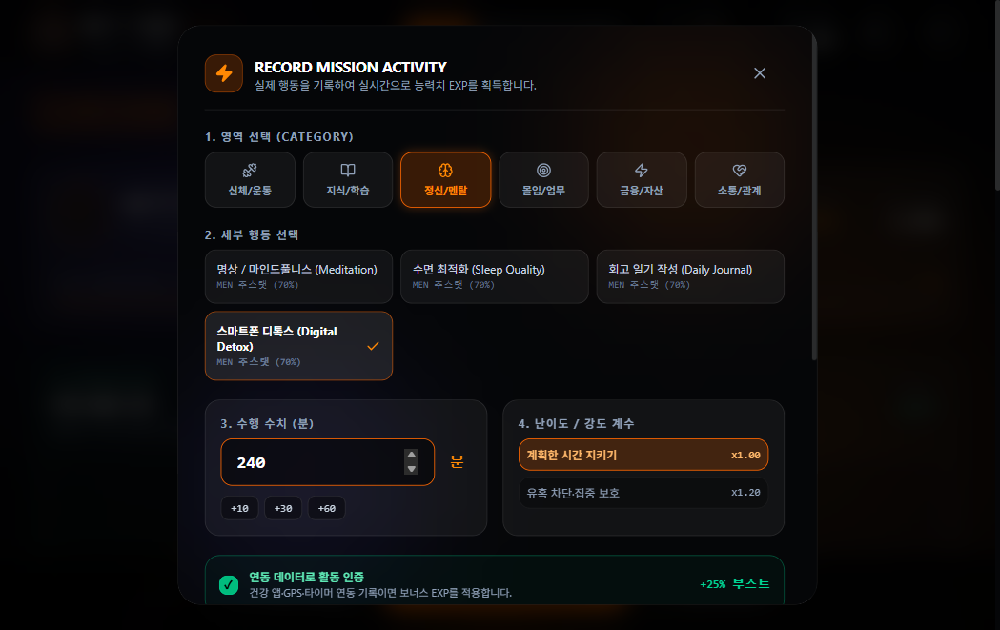
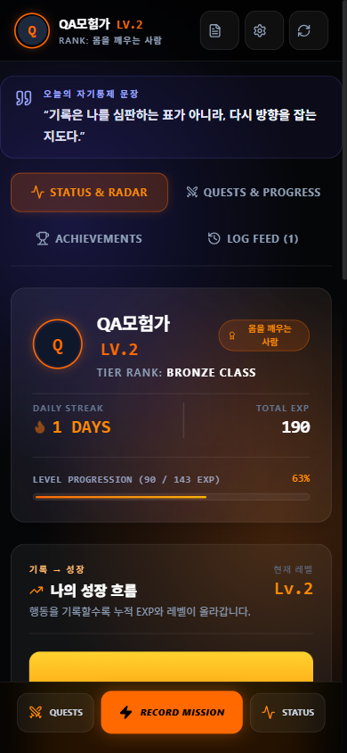

# LifeRPG

> **실제 행동을 기록하고, 성장의 흐름을 눈에 보이게 만드는 개인 성장 앱**

LifeRPG는 해야 할 일을 단순히 체크하는 데서 멈추지 않습니다. 몰입, 관계, 건강처럼 삶을 구성하는 활동을 기록하면 경험치·능력치·퀘스트·업적의 변화로 연결해, 작은 실천이 쌓이는 과정을 한 화면에서 돌아볼 수 있게 합니다.



## 왜 만들었나요?

일상의 성장 목표는 쉽게 추상적으로 남습니다. LifeRPG는 **행동 기록 → EXP 계산 → 능력치·퀘스트 갱신 → 변화 확인**의 짧은 피드백 루프를 통해, 사용자가 오늘 한 일을 다음 행동의 동력으로 바꾸도록 설계했습니다.

## 경험 설계

| 순간 | 사용자가 하는 일 | 앱이 돕는 방식 |
| --- | --- | --- |
| 시작 | 닉네임과 성장 방향을 정한다 | 예시 데이터 없이 `Lv.1 / EXP 0`에서 출발 |
| 기록 | 실제 활동, 수치, 난이도, 메모를 남긴다 | 입력값을 확인하고 최근 중복 기록을 방지 |
| 성장 | EXP와 스탯 변화를 확인한다 | 퀘스트·업적·성장 그래프로 연결 |
| 회고 | 잘못된 기록을 고치거나 백업한다 | 수정·삭제 후 통계를 다시 계산하고 JSON 백업·복원을 지원 |

### 핵심 기능

- 활동별 경험치와 능력치 계산
- 일일 퀘스트, 업적, 레벨업, 칭호 흐름
- 활동 기록 수정·삭제 및 통계 재계산
- 로컬 JSON 백업·복원·초기화
- 알림 권한, 리마인더, 햅틱 피드백, 분석 동의 설정
- 로컬 게스트 모드와 향후 동기화 상태 표시

## 모바일 우선 UX

LifeRPG는 웹앱과 모바일 셸을 함께 고려해 설계했습니다.

- Safe Area, `viewport-fit=cover`, `dvh` 기반 레이아웃
- 최소 44px 터치 영역과 터치 피드백
- 활동 기록·온보딩·칭호·레벨업에 맞는 바텀시트
- 숫자 입력의 `inputMode`, `prefers-reduced-motion` 대응
- PWA fallback용 매니페스트와 기본 아이콘

| 데스크톱 | 모바일 |
| --- | --- |
|  |  |

## 기술 구성

- **Frontend:** Vite, React 19, TypeScript
- **Mobile shell:** Capacitor for Android and iOS
- **Storage:** 브라우저 `localStorage` 기반의 로컬 우선 저장
- **Distribution:** 웹앱과 PWA fallback, Android/iOS 네이티브 프로젝트 포함

## 실행

```bash
npm install
npm run dev
```

검증 및 모바일 준비 명령은 다음과 같습니다.

```bash
npm run lint
npm run build
npm run mobile:build
npm run mobile:open:android
npm run mobile:open:ios
```

## 현재 범위와 다음 단계

현재 버전은 개인 기기의 로컬 저장을 우선합니다. 로그인·서버 동기화·실제 푸시 알림·Health/GPS 연동은 아직 연결하지 않았습니다. 이러한 기능을 추가할 때는 계정, 동의, 접근 제어, 내보내기·삭제와 함께 별도 설계할 예정입니다.

Android 빌드는 Android Studio와 SDK가 필요하며, iOS 설치·서명은 macOS와 Xcode 환경에서 진행해야 합니다. 자세한 모바일 전환 및 운영 메모는 [MOBILE_APP.md](MOBILE_APP.md)에서 확인할 수 있습니다.

---

**Design note:** 이 문서는 문제, 사용자 흐름, 실제 적용 화면, 기술 근거, 범위의 순서로 구성했습니다. 구현되지 않은 기능은 로드맵으로 명확히 구분합니다.
